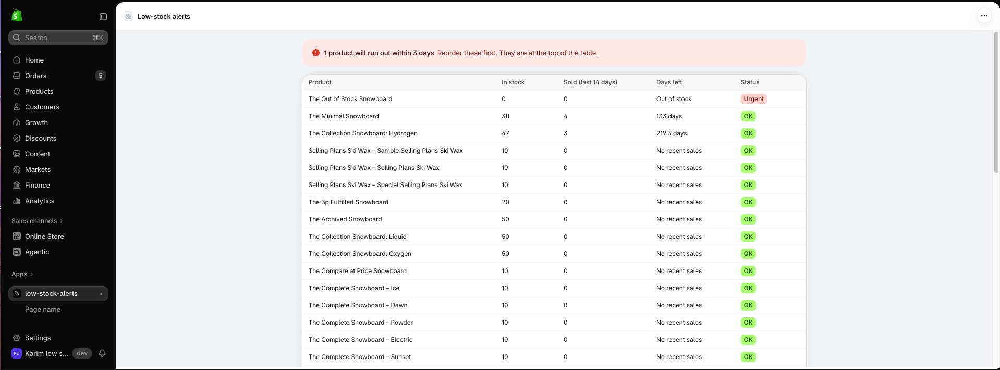
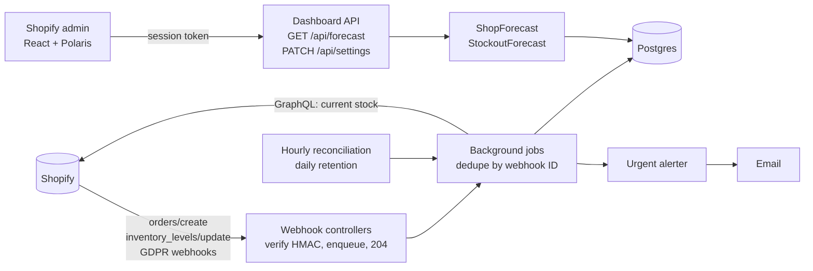

# Low-Stock Alerts

[](https://github.com/Kmsasaleh/low-stock-alerts/actions/workflows/ci.yml)

An embedded Shopify app, built with Ruby on Rails, that forecasts how many days each product has left before it sells out and alerts the merchant before it happens.

It tracks inventory and recent sales for every variant, updates in real time through Shopify webhooks, and shows a dashboard inside the Shopify admin with products sorted by urgency.



## Features

- **Install through OAuth** on a Shopify store (`shopify_app` gem, token exchange for embedded auth)
- **Initial sync** of products, variants and inventory through the GraphQL Admin API, with cursor pagination
- **Sales history import** of the last 60 days of orders (the `read_orders` limit)
- **Stockout forecast**: days left = units in stock / average daily units sold, with edge cases for zero stock, negative stock and no recent sales
- **Real-time updates** from `orders/create` and `inventory_levels/update` webhooks, verified, deduplicated and processed in background jobs
- **Hourly reconciliation** with Shopify to repair anything a webhook missed
- **Dashboard** in the Shopify admin (Polaris web components): banner, sortable table with status badges, per-shop threshold settings
- **Email alerts** sent once when a product becomes urgent, and again only if it recovers and becomes urgent later
- **Privacy**: no customer personal data stored, 90-day retention, working GDPR webhooks, in-app data note

## Tech stack

| Area | Choice |
|---|---|
| Backend | Ruby 3.4, Rails 7.1, ActiveRecord, ActiveJob |
| Shopify | `shopify_app` 23, `shopify_api` 16, GraphQL Admin API, app-specific webhook subscriptions |
| Frontend | React 18, Polaris web components (`polaris-2.js`), App Bridge |
| Jobs | Solid Queue (Postgres-backed, runs inside Puma, recurring schedules) |
| Database | PostgreSQL in production, SQLite locally and in tests |
| Quality | Minitest (53 tests), WebMock, Mocha, RuboCop with `rubocop-shopify`, GitHub Actions |
| Deploy | Docker image on Render |

## Architecture



**Data model**

| Table | Purpose | Key constraint |
|---|---|---|
| `shops` | Installed stores and their (expiring) access tokens | from the template |
| `variants` | Product variants and current stock | unique `(shop_id, shopify_gid)` |
| `sale_lines` | One row per order line item | unique `(shop_id, shopify_line_item_id)` |
| `processed_webhooks` | Webhook deliveries already handled | unique `webhook_id` |
| `settings` | Per-shop thresholds, sales window, alert email | unique `shop_id` |

## Design decisions

**Unique indexes are the source of truth for idempotency.** Every write that can repeat (sync, import, webhook) is an `upsert_all` against a unique index (`INSERT ... ON CONFLICT`). Running anything twice produces the same rows.

**One line-item ID format everywhere.** Webhooks send numeric IDs; the GraphQL importer stores global IDs. The webhook job converts to `gid://shopify/LineItem/<id>`, so a sale seen by both paths is one row. Verified on real data: re-running the importer after a webhook left the row count unchanged.

**Dedupe on `X-Shopify-Webhook-Id`, not `X-Shopify-Event-Id`.** The event ID is shared across deliveries from one merchant action; the webhook ID identifies a single delivery.

**Controllers only verify, enqueue and return 204.** Shopify times out after 5 seconds and retries non-2xx responses, so all real work happens in jobs. Signature checks use a constant-time comparison and fail closed when the secret is missing.

**`orders/create`: claim and write in one transaction.** If the sale-line upsert fails, the claim rolls back too, so Shopify's retry is processed instead of being skipped as a duplicate. A test forces the failure and proves the retry succeeds.

**`inventory_levels/update`: no transaction around the network call, and fetch the truth instead of applying the delta.** The payload's `available` is for one location; the job asks Shopify for the variant's total. Setting an absolute value is idempotent and order-independent, so no transaction is needed, and none is held open during an HTTP request.

**Webhooks for speed, reconciliation for correctness.** Webhooks are fast but not guaranteed. An hourly job re-syncs every shop, one job per shop, so one failing shop can't block the others.

**Atomic, once-per-problem email alerts.** `UPDATE variants SET urgent_alerted_at = now WHERE id = ? AND urgent_alerted_at IS NULL` lets exactly one caller win. The timestamp resets when stock recovers. Alerts are at-most-once by choice: a failed send loses one email instead of risking duplicates, and the dashboard banner still shows the problem.

**Per-shop settings created race-free.** `create_or_find_by!` inserts first and falls back to a read on the unique index, so concurrent first requests can't create two rows. The sales window is capped at 60 days because `read_orders` only returns 60 days of orders.

**Functional core, imperative shell.** `StockoutForecast` is pure math with unit tests for every edge case; `ShopForecast` does one grouped query and calls it.

**Polaris web components over Polaris React.** Shopify's migration guide describes web components as the target for embedded apps. With React 18, the settings form uses uncontrolled fields, since controlled custom-element fields need React 19.

## Bugs found and fixed

**Expiring access tokens.** The template enables 60-minute offline tokens. A service built its API session from the stored token directly, so it failed with `401 Invalid API key or access token` once the token expired. Unit tests couldn't catch it because they use a fake client; a live test against the dev store did. The fix routes every call through `shop.with_shopify_session`, which refreshes the token under a row lock before use, plus a test that the real code path goes through it and a retry for Shopify HTTP errors.

**The template's GDPR webhooks were broken.** Routes pointed at `CustomersRedactController` while the file defined `CustomerRedactController`; controllers enqueued `CustomerRedactJob` while the job was `CustomersRedactJob`; and `shop/redact` returned success without deleting anything. I wrote failing request tests first, then fixed the names and implemented real erasure.

## Deployment

The app is containerised (`Dockerfile` at the repo root) and was deployed to Render with PostgreSQL. In production, Solid Queue runs inside the Puma process and schedules the hourly reconciliation and daily retention jobs from `config/recurring.yml`.

Trade-offs of this setup, chosen to keep hosting free:

- Render's free web service sleeps after 15 minutes idle. The first webhook to a sleeping app fails and Shopify's retry delivers it, and scheduled jobs only run while the app is awake.
- The free Postgres database expires after 30 days.
- Installing on a production store needs either App Store review (public apps must pass review before subscribing to protected-data topics such as `orders/create`) or custom distribution. The demo runs on a development store.

## Known limitations

- Orders with more than 25 line items are only partly imported.
- Refunds after import are only reflected when reconciliation re-imports the order.
- Variants deleted in Shopify stay in the local database.
- Archived and draft products appear in the dashboard.
- No special handling for brand-new products with little sales history.

## Running locally

Requirements: Ruby 3.4.12, Node.js, the Shopify CLI, a Shopify Partner account and a development store.

```bash
git clone https://github.com/Kmsasaleh/low-stock-alerts.git
cd low-stock-alerts/web
bundle config set --local without production
bundle install
bin/rails db:prepare
cd ..
shopify app dev
```

Tests and lint:

```bash
cd web
bin/rails test
bundle exec rubocop
```

Maintenance tasks:

```bash
bin/rails shops:sync
bin/rails data:prune
```

## What I learned coming from Spring Boot and FastAPI

| Rails | Closest equivalent I knew |
|---|---|
| ActiveRecord models and associations | JPA entities, SQLAlchemy models |
| Migrations and `schema.rb` | Flyway / Alembic |
| Strong parameters | Request DTOs / Pydantic models |
| ActiveJob with Solid Queue | `@Async` with a queue, Celery |
| `retry_on` with backoff | Spring Retry `@Retryable` |
| Rake tasks | `CommandLineRunner`, CLI scripts |
| Minitest with Mocha | JUnit with Mockito, pytest with mocks |
| Convention over configuration | explicit wiring and annotations |

The biggest adjustments were trusting naming conventions (a misnamed file breaks autoloading and routing, as the GDPR bug showed), and leaning on database constraints rather than application checks for correctness under concurrency.
